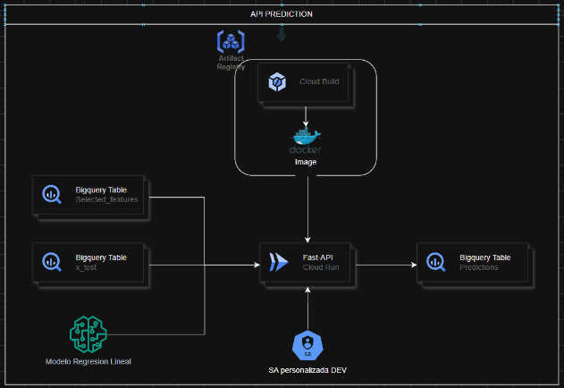
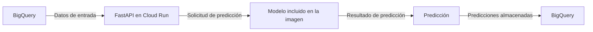

# API de Predicción en Cloud Run

Una API de predicción funcional ejecutándose en Cloud Run, con el modelo incluido en la imagen Docker, 
construida mediante Cloud Build, almacenada en Artifact Registry, ejecutada con una cuenta de servicio 
personalizada, consumiendo datos desde BigQuery y almacenando las predicciones en BigQuery.  

## Arquitectura de referencia



### Descripción del flujo de datos



1. Los datos de entrada se obtienen desde BigQuery.
2. La API de predicción, desplegada en Cloud Run, recibe los datos y realiza las predicciones utilizando el modelo incluido en la imagen Docker.
3. Las predicciones generadas se almacenan nuevamente en BigQuery para su posterior análisis y uso.

## Cloud Run deployment

No ejecutar estos comandos a menos que tu proyecto de GCP esté configurado.

Configura las variables:

```bash
export PROJECT_ID="your-gcp-project-id"
export REGION="region"
export SERVICE_NAME="service-name"
export IMAGE_REPOSITORY="images-repository"
export IMAGE_URI="${REGION}-docker.pkg.dev/${PROJECT_ID}/${IMAGE_REPOSITORY}/${SERVICE_NAME}:latest"
```

Construye y sube la imagen con Cloud Build:

```bash
gcloud builds submit \
  --config cloudbuild.yaml \
  --substitutions=_IMAGE_URI="${IMAGE_URI}" \
  .
```

Despliega usando el manifiesto del servicio:

```bash
envsubst < service.yaml | gcloud run services replace - --region "${REGION}" --project "${PROJECT_ID}"
```

Variables usadas por los placeholders de `service.yaml`:

- `SERVICE_NAME`
- `REGION`
- `IMAGE_URI`
- `SERVICE_ACCOUNT_EMAIL` (opcional: puede dejarse vacío si no es necesario para tu configuración)

Ejemplo:

```bash
export SERVICE_ACCOUNT_EMAIL="your-sa@${PROJECT_ID}.iam.gserviceaccount.com"
envsubst < service.yaml | gcloud run services replace - --region "${REGION}" --project "${PROJECT_ID}"
```
Haz que el servicio sea público. Esto se hace una vez, con tu propia cuenta:

```bash
gcloud run services set-iam-policy "${SERVICE_NAME}" gcr-service-policy.yaml --region "${REGION}" --project "${PROJECT_ID}"
```
Nota: Asegúrate de que la cuenta de servicio tenga los permisos necesarios para acceder a BigQuery y ejecutar trabajos de predicción. 

Usa el siguiente comando para asignar los roles `bigquery.jobUser` y `bigquery.readSessionUser` a la cuenta de servicio a nivel de proyecto:

```bash
gcloud projects add-iam-policy-binding "${PROJECT_ID}" \
  --member="serviceAccount:${SERVICE_ACCOUNT_EMAIL}" \
  --role="roles/bigquery.jobUser"
gcloud projects add-iam-policy-binding "${PROJECT_ID}" \
  --member="serviceAccount:${SERVICE_ACCOUNT_EMAIL}" \
  --role="roles/bigquery.readSessionUser"
```

Para leer y escribir en las tablas, asigna el rol `bigquery.dataEditor` al dataset:

```bash
bq add-iam-policy-binding "${PROJECT_ID}:dataset-id" \
  --member="serviceAccount:${SERVICE_ACCOUNT_EMAIL}" \
  --role="roles/bigquery.dataEditor"
```
O a nivel de proyecto:

```bash
gcloud projects add-iam-policy-binding "${PROJECT_ID}" \
  --member="serviceAccount:${SERVICE_ACCOUNT_EMAIL}" \
  --role="roles/bigquery.dataEditor"
```


